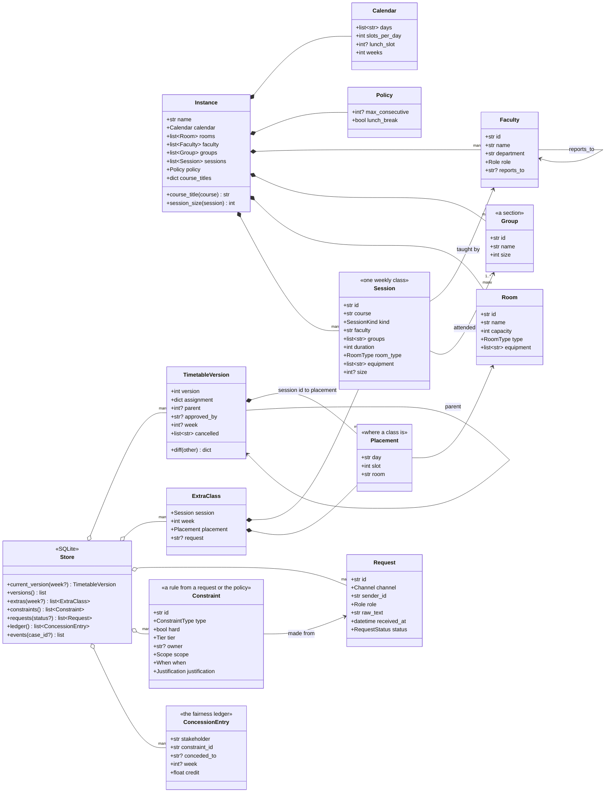
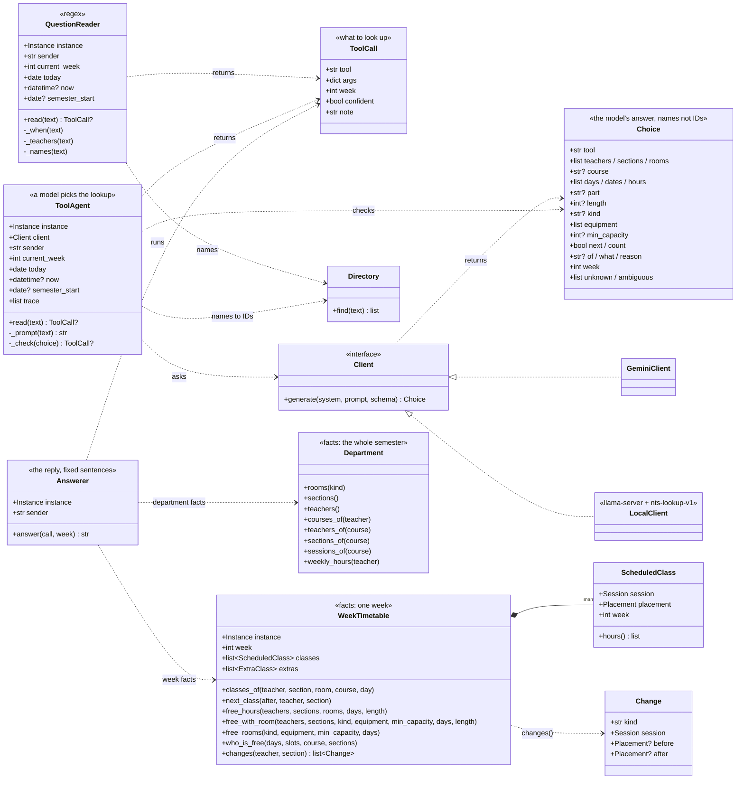
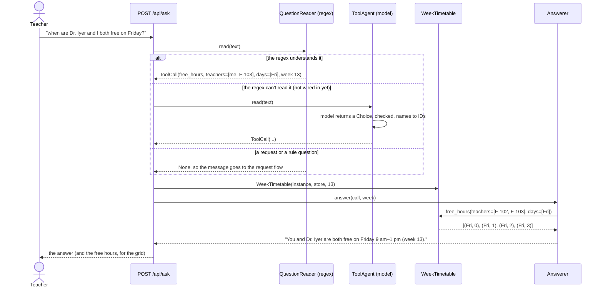

# Classes behind the timetable questions (`f-lookup`)

Three diagrams: **the data** the questions are answered from, **the lookup classes** that read it, and **how one
question flows** through them. At the end, the data no tool reads yet: candidates for new tools.

The diagrams are [Mermaid](https://mermaid.js.org/syntax/classDiagram.html): GitHub shows them as pictures; in VS
Code, open the Markdown preview (with a Mermaid extension). Types are simplified: `str?` means "a string or
nothing", `list~Room~` a list of rooms.

## 1. The data

Everything the questions are about. The **department** (`Instance`) comes from the department file and does not
change during the semester; the **timetable and the requests** live in the `Store` (SQLite) and change as
requests are published.

**Reading it:** a `Session` is one weekly class (e.g. the Data Structures lecture for Section 1); where it is held
is a `Placement` inside a `TimetableVersion`. Version `week = None` is the semester timetable; a version with a
week number is that week's own timetable (after an absence, a closed room), and its `cancelled` lists the
classes not held that week. Extra classes are separate (`ExtraClass`), for one week.

## 2. The lookup classes

What `f-lookup` adds. Left: **understanding** a question (regex or a model) into a `ToolCall`. Right: **facts**
(`WeekTimetable`, `Department`) and **the reply** (`Answerer`). The two sides only meet in the `ToolCall`, so a
misunderstanding can never change a fact.

**The six tools** are methods of `WeekTimetable` and `Department`; `ToolCall.tool` names one:

| `ToolCall.tool` | Method(s) |
|---|---|
| `free_hours` | `WeekTimetable.free_hours`, or `free_with_room` when a room is needed too |
| `classes_of` | `WeekTimetable.classes_of`, or `next_class` for "my next class" |
| `free_rooms` | `WeekTimetable.free_rooms` |
| `who_is_free` | `WeekTimetable.who_is_free` |
| `describe` | `Department` |
| `changes` | `WeekTimetable.changes` |
| `unclear` | none: the `note` is the reply ("I don't know a teacher called Smith.") |

## 3. One question, end to end

## 4. Data no tool reads yet: candidates for new tools

| Data | Class / method | Questions it could answer | Notes |
|---|---|---|---|
| who leads whom | `Faculty.role`, `Faculty.reports_to` | "who is the head of department?", "who do I report to?" | today read as "not a timetable question" (the test set even expects that) |
| preferences and unavailability | `Store.constraints()` | "what preferences have I given?", "when is Dr. Iyer unavailable?" | times only, never reasons (P-PRIVACY) |
| requests and their status | `Store.requests()`, `Store.events()` | "what happened to my swap request?" | also on the Requests tab |
| the fairness ledger | `Store.ledger()` | "how many times have I given way this semester?" | |
| timetable history | `Store.versions()`, `TimetableVersion.parent / approved_by` | "when did the timetable last change, and who approved it?" | |
| policy limits | `Instance.policy` | "how many hours in a row can I teach?" | answered by rule search today; the number is also data |
| what a class needs | `Session.equipment`, `room_type`, `Instance.session_size()` | "what does my DS lab need?", "how many students are in my ML class?" | `describe` covers part of it |
| club bookings | `semester.clubs` (not in the diagrams) | "is Room 103 booked on Friday evening?" | evenings, outside the teaching timetable |

The first three look the most useful: a `describe` for people (`role`, `reports_to`), a `my_requests` tool, and a
`constraints` tool that never shows a reason.
