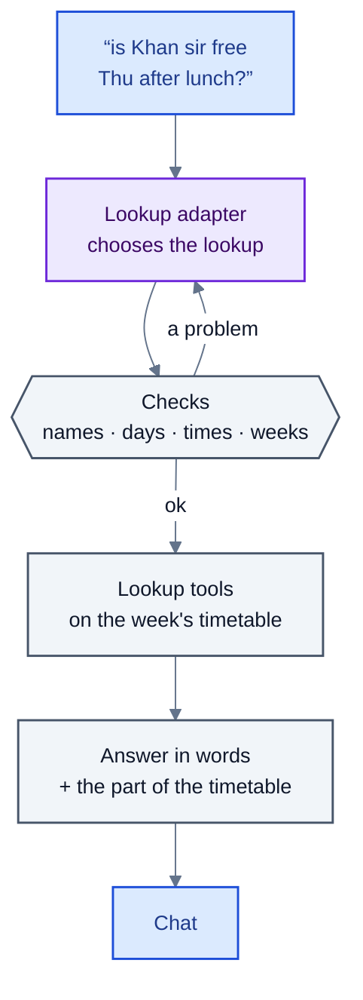
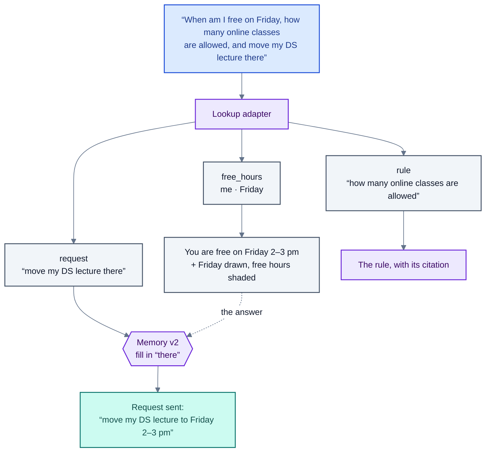

# The chat: timetable questions, mixed messages and memory

The home page has a chat beside the person's timetable. It answers questions about the timetable, answers
questions about the rules from the handbook, and takes requests, all in plain language and all in one message if
the person likes:

> When am I free on Friday, how many online classes are allowed in a week, and move my DS lecture there.

That message gets three replies: Friday's free hours (with Friday drawn beside the answer and the free hours
shaded on the timetable), the rule on online classes with its citation, and the request "move my DS lecture to
Friday 2–3 pm" sent into the request pipeline. A follow-up such as "and Thursday?" is understood from the
conversation before it.

This page explains how: the design rule the whole chat rests on, the lookup tools, how a message is read (four
generations of the lookup adapter, ending in a typed lookup vocabulary), how mixed messages are split, how memory
handles follow-ups, and what each step scores.

## The rule: the model chooses, the code answers

A language model never sees the timetable and never writes an answer. It only chooses **what to look up**: which
tool, about whom, when. Everything else is code:



- **The model writes names as the message writes them** ("khan sir", "sec 2", "lab-3", "the HOD"). The code finds
  who they are (`agents/lookup.py`, `Directory.find`) and, for roles, who holds the role today, so a new HOD needs
  no retraining. A name the department doesn't have, or one that fits several people, is said to the person
  ("Which one do you mean: Dr. Anil Das or Dr. Neha Das?"), not guessed.
- **Every choice is checked** before it runs (`agents/tool_agent.py`, `ToolAgent._check`): real days and hours,
  weeks inside the semester, a course that exists, the tool's required fields. A problem is sent back to the model
  with what is wrong ("lookup 2: no course is called …; choose again"), at most three tries in all; then the
  person is asked to put it another way.
- **The answer is computed** from the timetable of the week asked about, the requests, the rules and the bookings
  (`agents/questions.py`, `Answerer`), so it is always the timetable's answer, never the model's.
- **Private reasons stay private.** "Why is Dr. Rao away?" gets "I can't say why someone is away: the reasons
  are private", not a lookup of their request.

## The lookup tools

Sixteen tools, each a plain function over one week's timetable (`agents/lookup.py`, `WeekTimetable`) or over the
records the timetable doesn't hold (`agents/more_lookups.py`, `Records`):

| Tool | Answers | Example |
|---|---|---|
| `free_hours` | When everyone named is free; hours in a row; only the earliest; a room needed too | "when are Dr. Rao and I both free for 2 hours on Thursday?" |
| `classes_of` | Classes of a person, section, room or course; the next class; how many | "what's in Lab 3 on Friday?" |
| `free_rooms` | Free rooms by kind, equipment, size | "a lab with GPUs free on Tuesday afternoon" |
| `who_is_free` | Which teachers or sections are free; who could cover a class | "who could take my 10 am class on Tuesday?" |
| `describe` | Facts that don't change by week: rooms, sections, teachers, courses, the calendar | "how big is Section 4?" |
| `changes` | How a week differs from the usual timetable | "was my class cancelled next week?" |
| `calendar` | Which week it is, a week's dates, weeks left | "what dates does week 14 cover?" |
| `my_requests` | The asker's requests and their state | "has R-00018 been approved?" |
| `my_rules` | The wishes and absences the asker has set | "what preferences have I set?" |
| `clash_check` | Whether people, sections or rooms overlap | "do sections 2 and 3 clash on Monday?" |
| `move_options` | Where one of the asker's classes could go this week | "where could my OS lecture move?" |
| `counts` | Totals and rankings | "who teaches the most hours?" |
| `gaps` | The longest free block, or the longest run of classes | "my longest break on Wednesday?" |
| `my_fairness` | How often the asker has given way | "how often have I conceded?" |
| `bookings` | Club room bookings | "is the coding club's booking confirmed?" |
| `what_if` | A dry run: what would move if a change were made | "what if I moved my Monday lab to Friday?" |

Plus `unanswerable` (a private reason; a holiday or exam date the data doesn't have) and the parts that are not
questions at all (see [mixed messages](#mixed-messages)). Every tool that depends on the week also takes several
weeks at once ("my free hours in weeks 10 to 12": the hours free in every one of them, then each week).

**The view beside the answer** (`agents/views.py`). The reply carries the part of the timetable it is about,
computed with the same lookups and filters as the words, so the picture and the text agree: a week grid (days
across, hours down) for free hours, classes and changes, or rows for one day (one row per room or person) for
"which rooms are free" and "who is free". Free hours are also shaded green on the person's own timetable.

## Reading a message: four generations

| Version | What it reads | How it answers | In use |
|---|---|---|---|
| Regex (`agents/questions.py`, `QuestionReader`) | One question; set phrasings | A `ToolCall` | Whenever the model is away |
| `nts-lookup-v1` | One question, the department's names listed in the prompt | One flat choice | |
| `nts-lookup-v2` | New kinds of question, roles ("the HOD"), shared courses, two teachers on one course | One flat choice | |
| `nts-lookup-v3` | Up to 5 lookups a message, the ten newer tools, names as written | A list of flat choices; a `none` for anything that isn't a question | **Yes** |
| `nts-lookup-v4` | Up to 8 parts a message, in a typed vocabulary; requests and rule questions keep their words | `LookupsV4` | Trained and evaluated |

`World.read_message` picks the reading by the adapter's name (`lookup_version`). v3 and v4 read every message,
request words or not, because both were trained on messages that mix questions and requests; before v3, a message
with request words ("please move", "cancel", "can I have") went straight to the request pipeline.

### The lookup vocabulary (v4)

v3 answers with one flat choice per lookup: about thirty optional fields that any tool may carry, slot numbers for
times and week numbers for weeks. The model has to do arithmetic ("after lunch" is slots 5–7; "next week" is
week 14) and can put a field on a tool that ignores it.

v4 (`agents/lookups_v4.py`) answers in a small typed vocabulary, built the same way as the request vocabulary
(`language/intents.py`):

- **A part per thing asked**, in order, each part one tool with **only that tool's fields** (a discriminated union
  on `tool`: 17 tools plus `request`, `rule` and `other`).
- **Shared pieces**: `who` (teachers, sections, rooms as written, roles, `unknown` for a student's name or the
  auditorium), `when` (days, `today`/`tomorrow` as said, calendar dates, `morning`/`afternoon`, clock times `at`,
  `after`, `before`, and the request vocabulary's `period`: `next_week`, weeks, from/to, a count), `room` (kind,
  equipment, capacity, sections it must seat) and `which` (the class `move_options` moves).
- **Clock times and periods, not numbers.** The model writes "14:00" and `next_week`; the code works out the
  slots and weeks with the same functions requests use (`language.intents.slots`, `weeks`).
- **Requests and rule questions keep their own words** (`request` and `rule` parts with `text`), so the chat can
  answer the rule question alone and send only the request.

```json
{"parts": [
  {"tool": "free_hours", "who": {"teachers": ["me"]}, "when": {"days": ["Fri"]}},
  {"tool": "rule", "text": "how many online classes are allowed in a week"},
  {"tool": "request", "text": "move my DS lecture there"}
]}
```

`to_choice` turns each part into v3's choice, so the same checks, the same `Answerer` and every test set serve v3
and v4 alike; `from_choice` goes the other way and built v4's training rows from v3's (each row kept only when
both readings give the same lookups). v4's prompt is a third shorter than v3's (3,805 characters against 5,786).

## Mixed messages

One message can hold timetable questions, requests, a rule question and small talk. `World.read_message` returns
the lookups and the other parts (`Other`: a request, a rule question, or something to leave out), and
`chat_send` replies to each (`web/app.py`, `_other_parts`):



- **Questions** are answered in order; several lookups give one reply with each answer.
- **A rule question** is answered from the handbook from its own words (v4), with every rule cited; with no rule
  found, the chat says so honestly rather than quoting the nearest rule.
- **Requests** go into the request pipeline, all request parts of the message together; the reader there turns
  each into an intent. With v3, whose `none` part keeps no words, the whole message is what is sent.
- **Request words beside the lookups** count as a request even when the model left the request out, so a request
  is never silently dropped.
- **With the model away**, request words make the whole message a request (the regex would misread it as a
  question), and a plain question the regex can't read is told to try again shortly rather than sent on as a
  request.

## Memory: follow-ups

People talk to the chat as they would to a person: "and Friday?", "what about Dr. Rao?", "is she free then?",
"move it there", "has it been approved?". Every other adapter reads messages that stand on their own, so memory
(`agents/memory.py`, the `nts-memory` adapter) runs first and makes the message stand on its own.

- **Input**: the newest message and the last four before it (the person's last two and the two replies), each
  reply cut to its first 400 characters. Older messages are not seen: what matters from long ago is in the
  database (requests, rules, the timetable), and the lookup tools reach it.
- **Output**: exactly one of `{"same": true}` (most messages), `{"message": "…"}` (the message in full, in the
  person's own words), or `{"ask": "…"}` (it leans on something the conversation doesn't have: "Which room do you
  mean?").
- **Checked, not trusted**: a rewrite may name only teachers, sections, rooms, courses and request numbers that
  the message or the conversation has; anything else is sent back (two tries), then the message goes on as
  written.
- **It never answers and never looks anything up.** What it writes goes the usual way: to lookup, to the rules or
  to the request pipeline. The person sees what their message was read as.

| Version | Adds | Status |
|---|---|---|
| Memory v1 | Follow-ups between messages, 16 kinds: `change` ("and Friday?"), `refer` ("is she free then?"), `relative` ("next week?"), `list` ("the second one"), `two_back` (two messages back), `chain`, `two`, `both`, `each`, `reply`, `request` ("move it there"), `whatif`, `yes`, `mixed`, `ask` (ask back), and `same` (a quarter of the rows: leave it alone) | **In use** |
| Memory v1.1 | Plurals: "these days" (every day just asked about), "those times" (every free span the reply gave), "the same time for X" (another person in place of the earlier one); more of v1's weakest kinds | Trained from v1's adapter; to be evaluated |
| Memory v2 | A request that leans on the answer **in the same message** ("when am I free on Friday? move my DS lecture there") | Code; uses v1's adapter |

**Memory v2** (`web/app.py`, `_resolved`). Memory works between messages; here "there" is the answer to the
message's own question. So the chat answers the questions first, then gives memory the questions and their answer
as if they were the chat just before the request, and memory does exactly what it was trained to do. One free
time: the request is sent in full, with the words as said kept beside it (`said`). Several free times: memory
picking one would be a guess, so the code checks (an answer with several time spans and a request saying "there"
or "then") and the chat asks "Which time do you mean: 9–11 am or 2–4 pm?"; the answer is read as a follow-up, with
memory told what the question was about.

## Results

All on the GPU server, scored by what each reading resolves to (the lookup and its arguments), not its wording.
How each set is built is in [evaluation.md](evaluation.md).

**Single questions** (362 questions from 142 templates; set A in the app's department, C with names, the HOD and
course titles shuffled, D a department never seen, with shared and co-taught courses):

| Reader | A | C | D |
|---|---|---|---|
| Regex | 242 | | |
| Gemini (prompted) | 320 | | |
| `nts-lookup-v1` | 329 | 329 | 327 |
| `nts-lookup-v2` | 347 | 343 | 345 |
| `nts-lookup-v3` | **346** | **346\*** | **343\*** |
| `nts-lookup-v4` | 337 | 340 | 333 |

\* counted again with today's labels; v1 and v2 were scored with the labels of their time. Steady across
departments: the adapters read, they did not memorise the demo department.

**Long and mixed messages** (200 messages, 1 to 5 questions, 0 to 2 requests, a rule question in 34; 72 joined in
ways the training data never joins them):

| | v3 | v4 |
|---|---|---|
| Whole message right | 111 | **140** |
| Question parts right (of 561) | 440 | **483** |
| Requests found (of 123 messages with one) | 112 | **122** |
| Requests and rule questions counted right | 171 | **191** |
| Joined in new ways (of 72) | 36 | **52** |

**In the chat itself** (messages sent through the app as a teacher):

| | v3 | v4 |
|---|---|---|
| A question and a request or rule question in one message (26 cases) | 25 | **26** |
| Memory v2: a request leaning on the answer (8 cases) | – | **7** |

**Follow-ups** (400 test conversations through memory, then lookup):

| | Right |
|---|---|
| End to end, memory v1 then lookup v3 | 387 |
| End to end, memory v1 then lookup v4 | **388** |
| Memory's rewrite alone | 385 |
| Read as typed, without memory | 146 |

Memory is what makes follow-ups work: without it, fewer than four in ten are looked up right.

**What the numbers say.** v4 is clearly better where it was aimed (mixed and long messages, finding requests,
the chat) and slightly behind v3 on single questions. The losses are the same few kinds in every department, so
they are forgotten rather than memorised: "in week N" read as week N−1, "can I have Thursday free?" read as a
question, "why was X's class cancelled?" looked up instead of kept private, and "who else teaches X and is
free?". None of them is in v4's new training data; a top-up from v4's adapter with those rows is the planned
fix. See [limitations.md](limitations.md).

## Files

| Path | What |
|---|---|
| `src/agents/tool_agent.py` | `ToolAgent`: prompts, checks, retries; `ChoiceV3`, `Lookups`, `Other` |
| `src/agents/lookups_v4.py` | The lookup vocabulary, its prompt, `to_choice`, `from_choice` |
| `src/agents/lookup.py`, `more_lookups.py` | The lookup tools |
| `src/agents/questions.py` | The regex reader and `Answerer` |
| `src/agents/views.py` | The part of the timetable to draw beside an answer |
| `src/agents/memory.py` | Memory: prompt, checks, `turns_of` |
| `src/web/world.py` | `read_message`, `followup`, `answer_rule`, `lookup_version` |
| `src/web/app.py` | `chat_send`, `_other_parts`, `_resolved` |
| `src/training/lookup_data*.py`, `memory_data*.py` | Training data |
| `src/evaluation/lookup_set.py`, `multi_set.py`, `memory_set.py`, `end_to_end.py` | Test sets and scoring |
| `before_after/` | Before-and-after records of each change to the chat, with every reply |
| [docs/lookup-classes.md](../lookup-classes.md) | The lookup classes and their data, in depth |
