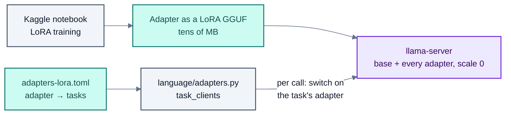
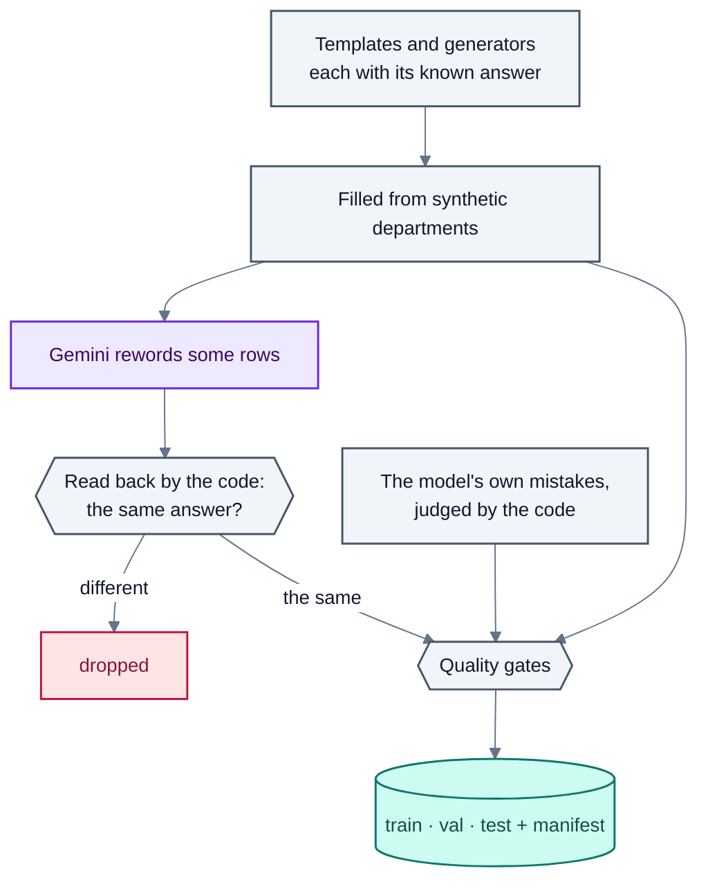
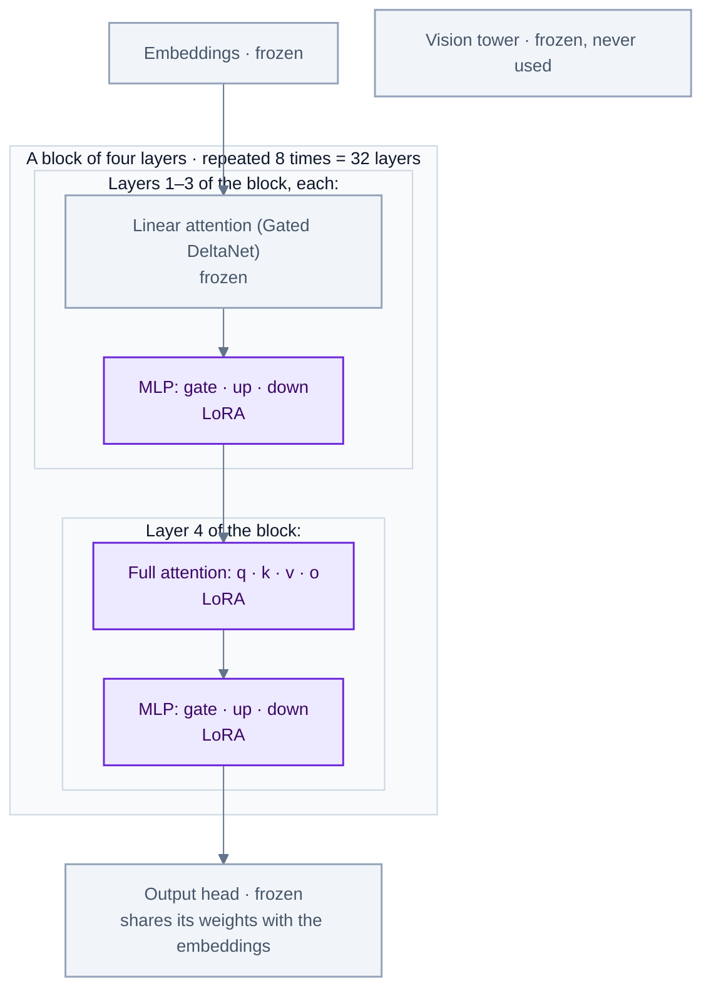

# Models and training

Every language task in the system is done by one small base model with a LoRA adapter per task. This page lists
the adapters, how they are served and swapped, how their training data is made and checked, and how they are
trained on Kaggle.

## Why one base and an adapter per task

- **Each task is narrow.** Reading a request, reading a timetable question, rewriting a follow-up and checking a
  policy are different jobs with different output formats. A small model learns one well; one model learning all
  of them takes 14+ hours to retrain for any change.
- **Each adapter is retrained alone**, in a few hours on a free Kaggle GPU, and measured alone, so a change to the
  chat never puts request reading at risk.
- **The learning curve said so.** On the multi-task model, the policy and reply scores at half the training equal
  those at all of it; only reading requests gains from the rest.
- **The model never decides anything that code can compute.** Adapters read language into small typed vocabularies
  (intents, lookups, a rewrite); names, dates, weeks, slots, rules and the timetable are the code's.

## The base model

**Qwen3.5-4B**, quantised to Q8_0 GGUF, served by llama.cpp's `llama-server`. The 4B model replaced the 2B one used
early on: both read requests equally well (97.8% exact compile), but the 4B one decides what to do with a message
more often correctly (action accuracy 99.3% against 96.5%).

## The adapters

| Task | Adapter (in use) | Reads into | Training rows | Trained from |
|---|---|---|---|---|
| `compile` | `nts-intents-v12-read-100` | `IntentOutput`: an action and intents (17 kinds) | 4,363 (intents v12) | the base |
| `policy`, `reply`, `explain` | `nts-read100` | A policy verdict with cited rules; one tool call for a stakeholder's reply; a grounded explanation | 6,570 multi-task rows | the base |
| `lookup` | `nts-lookup-v3` | `Lookups`: up to 5 lookups a message, and the parts that aren't questions | 2,503 + 583 rewordings | v2's adapter |
| `memory` | `nts-memory-v1` | `{"same"}`, `{"message"}` or `{"ask"}` | 2,520 + 701 rewordings | the base |

Trained and evaluated, not yet in use:

| Adapter | What changes | Training rows | Trained from |
|---|---|---|---|
| `nts-lookup-v4` | The lookup vocabulary (`LookupsV4`): a part per thing asked, each tool its own fields, clock times, requests and rule questions with their words | 2,354 + 571 rewordings | v3's adapter |
| `nts-lookup-v3_2` | v3's format on the same new rows as v4 (to compare the format alone) | the same rows | v3's adapter |
| `nts-memory-v1_1` | Plurals ("these days", "those times", "the same time for X") | 1,850 (900 new) + 400 | v1's adapter |
| `nts-intents-v13` | Two more generators (`same_day_part`, `answered`) and an alternate-weeks reading repair | 4,623 | the base |

### Versions of each adapter

**Reading requests** (`nts-intents-*`). Each version is built from a recipe (`data/recipes/intents-v*.toml`) that
adds generators for what the previous version got wrong, measured on 24 held-out suites (see
[regression-matrix.md](../regression-matrix.md)). v12 added `move_pairs`, `limit_firmness`, `relation_pairs` and
`out_for_me`: 96.4% outcome match on the test split, and 97.5–100% on the suites v11 missed. The suffix
`read-100` is the point on the learning curve: the adapter after reading 100% of its training stream (the
notebooks also export `read-033` and `read-067`, after one and two of its three epochs).

**Timetable questions** (`nts-lookup-*`):

| Version | Rows | Added |
|---|---|---|
| v1 | 1,909 | One lookup per question; the department's names listed in the prompt |
| v2 | 2,976 | New kinds of question, roles ("the HOD", "the office", class representatives), shared and co-taught courses; a second test set |
| v3 | 2,503 + 583 | Up to 5 lookups a message; ten new tools (calendar, requests, rules, clashes, move options, counts, gaps, fairness, bookings, what-if); names as written, found by code; 150 mixed question-and-request messages |
| v3.2 / v4 | 2,354 + 571 | The same rows in two formats: mixed messages with request and rule words (806 request parts, 145 rule questions), long messages of 4 to 8 questions, 32 new templates for v3's slips |

**Follow-ups** (`nts-memory-*`): v1 (16 kinds of conversation, a quarter of them messages that already stand on
their own and must be left alone), v1.1 (`plural`, and more of v1's weakest kinds).

## Serving and swapping



- **One server, every adapter.** `llama-server` loads the base once and every adapter with
  `--lora-init-without-apply`, so none is applied until a call asks for it:

  ```sh
  llama-server -m Qwen3.5-4B-Base-Q8_0.gguf \
    --lora nts-intents-v12-read-100.gguf,nts-read100.gguf,nts-lookup-v3.gguf,nts-memory-v1.gguf \
    --lora-init-without-apply --jinja -ngl 99 -c 8192 --port 8080
  ```

- **Which adapter does what** is a file, `adapters-lora.toml` (another with `NTS_ADAPTERS`):

  ```toml
  base = "Qwen3.5-4B-Base-Q8_0"
  [adapters]
  nts-intents-v12-read-100 = ["compile"]
  nts-read100 = ["policy", "reply", "explain"]
  nts-lookup-v3 = ["lookup"]
  nts-memory-v1 = ["memory"]
  [schemas]            # the intent vocabulary an older adapter was trained on
  nts-intents-v6-read100 = 4
  ```

  Switching the chat to v4 is one line: `nts-lookup-v4 = ["lookup"]`. The app picks the reading code by the
  adapter's name (`World.lookup_version`).
- **Per call**, the client finds each adapter in the server's `/lora-adapters` and sends the task's adapter with
  the request. A server that serves an adapter as a model of its own name (a router preset, or a merged GGUF)
  works too (`adapters-router.toml`).
- **Older vocabularies keep working.** An intents adapter trained on an older schema is listed under `[schemas]`;
  it gets its own prompt and its readings are migrated to the current vocabulary (`language/migrations.py`).
- **Answers are cached** per adapter and prompt, so evaluations of an unchanged adapter rerun from the cache.
- **Grammar-constrained output.** A local model is held to its answer's JSON shape by a grammar built from the
  schema (`GrammarLookups`, `GrammarChoice`), so it can't write a field the schema doesn't have.

## Making training data

No data was collected from real users; every row is generated, or reworded and checked, with its correct reading
known by construction.



- **Templates and generators.** A template is a wording with slots ("when is {teacher} free {when}?") and the
  answer it should get; a generator writes whole messages of one kind (a move, a limit, a choice between two
  times) with their intents. They are filled from synthetic departments (`core/generator.py`) and from shuffled
  copies of the demo department, so a model learns to read, not to remember names.
- **Gemini rewordings** (`training/lookup_distill_v3.py`, `memory_distill.py`, `language/paraphrase.py`). Gemini
  rewrites some messages the way people write. A rewording is kept only when reading it back gives the same
  answer as the original.
- **Mining the model's own mistakes** (`training/mine.py`). A fresh pool of generated messages, never a test
  wording, is read by the current model and scored by the code; the misses, with their correct readings, become
  new rows.
- **Hand-written messages** (`training/human.py`, `data/human/`) go through the same gates as generated ones.
- **Quality gates** (`training/quality.py`). Every intents row passes four gates, whatever its source:
  `schema` (the answer is written in the current vocabulary, always the same way, so one meaning is one string to
  learn), `resolves` (the answer works against the row's own timetable and week), `rubric` (the checks run on a
  reading in the app would change nothing in it, so the data and the checks follow one rule) and `leak` (no
  training message is a test message with only the greeting, sign-off or spacing changed). The build writes a
  manifest of what is in the data.
- **Balance** (`training/balance.py`). Each kind of request is taught both alone and as a part of a longer
  message, so the habits of the combining generators don't become the kind's reading.
- **Recipes and a frozen test split** (`training/dataset.py`). The intents data is built from a recipe naming its
  sources and how much of each; the test split (417 requests) is frozen by hash and the build refuses to change it
  without saying why, so every version is scored on the same requests.
- **Test templates are never training templates.** The lookup and memory test sets are built from their own
  templates and wordings only.

Data builders by adapter:

| Adapter | Builder | Output |
|---|---|---|
| Intents | `training/dataset.py` with `data/recipes/intents-v*.toml`; `language/intent_generators.py`, `intent_corpus.py` | `data/compiler-intents/` |
| Multi-task (policy, reply, explain) | `training/distill.py` | `data/multitask/`, `data/multitask-readable/` |
| Lookup | `training/lookup_data.py`, `lookup_data_v3.py`, `lookup_data_v3_2.py`, `lookup_data_v4.py` | `data/lookup-train*/` |
| Memory | `training/memory_data.py`, `memory_data_v1_1.py` | `data/memory-train*/` |
| Encoder reader | `training/encoder_data.py`, `encoder_spans.py` | `data/encoder-intents*/` |

## What is trained, and why

### The base model's layers

Qwen3.5-4B is a **hybrid** model. Its language part has 32 layers, and each layer has two blocks:

- **A token mixer**, which lets each word look at the other words. In 24 layers this is **linear attention**
  (Gated DeltaNet: fast, with a running memory of the text so far); in 8 layers, every fourth one, it is
  ordinary **full attention**, with the usual query, key, value and output projections (`q_proj`, `k_proj`,
  `v_proj`, `o_proj`).
- **An MLP** (`gate_proj`, `up_proj`, `down_proj`), which transforms each word's representation; most of what
  the model "knows" lives here.

Around them: the **embeddings** (words in), the **output head** (words out), and a **vision tower** for images,
which this project never uses.

### Which layers get an adapter

All four kinds of adapter (intents, lookup, memory, the multi-task one) use the same LoRA settings: rank 16, on
every linear layer whose name ends in `q_proj`, `k_proj`, `v_proj`, `o_proj`, `gate_proj`, `up_proj` or
`down_proj`, outside the vision tower. On this model that means:



| Part | Adapted? | Trainable weights (rank 16) |
|---|---|---|
| Full attention, 8 layers (`q`, `k`, `v`, `o`) | Yes | 3.1 million |
| MLP, all 32 layers (`gate`, `up`, `down`) | Yes | 18.1 million |
| Linear attention, 24 layers (`in_proj_qkv`, `in_proj_z`, `in_proj_a`, `in_proj_b`, `out_proj`) | No | 0 |
| Embeddings, output head | No | 0 |
| Vision tower | No | 0 |
| **Total** | | **about 21 million, roughly half a percent of the model** |

(A LoRA adapter on a layer of size `in × out` adds `16 × (in + out)` weights. The counts come from the model's
published shapes: hidden size 2,560, MLP size 9,216, 16 query heads and 4 key-value heads of size 256.)

### Why these layers

- **LoRA instead of training the whole model.** The base model alone is about 17 GB in fp32. Training all of it
  needs its gradients and the optimizer's two running averages as well, roughly four times that, far beyond the
  two 15 GB GPUs a free Kaggle session gives. With LoRA the base stays frozen and only about 21 million weights
  train, so the optimizer's memory is small. The result is also small (tens of MB), so one base can serve every
  task and switch adapters per call.
- **The attention projections**: a task like ours is mostly about **finding and copying** the right words, such
  as the teacher's name in the message, the day, the time and the request's own words. Attention decides which
  words of the prompt each output word looks at, so adapting it teaches the model where to look in our prompt
  layout (`Asking:`, `Today:`, `Hours:`, `<question>…</question>`).
- **The MLPs**: the model must also **transform** what it reads into a vocabulary it never saw: tool names
  (`free_hours`), field names (`who`, `when`), and rules such as "after lunch" meaning `after: "14:00"`. That
  mapping is the kind of change the MLPs carry, and they are where most of the adapter's weights are. Adapting
  every linear layer, not attention alone, is also the usual advice for LoRA: the QLoRA study found
  attention-only adapters fall short of full fine-tuning, and all-layer adapters match it.
- **Not the vision tower**: every input is text, so the vision tower never runs; adapting it would only cost
  memory.
- **Not the embeddings or the output head**: the answers use words and JSON characters the model already has, so
  no new tokens are needed. They are also huge: the two share one matrix (the
  vocabulary is about 248,000 tokens, so about 636 million weights, thirty times the whole adapter), and
  training it would make each adapter more than a GB and break the "small file per task" setup.
- **Not the linear-attention layers: a side effect, not a choice.** The name pattern was written for ordinary
  transformer layers, and Qwen3.5's linear-attention layers name their projections differently, so they are left
  out. The adapters still learned their tasks well (96.4% on reading requests, 346/362 on timetable questions)
  with full attention in 8 layers plus all 32 MLPs. Adding `in_proj_qkv`, `in_proj_z` and `out_proj` to the
  pattern is an untested idea: it might help the harder readings (long and mixed messages), and llama.cpp's
  adapter export would have to support those layers.

### The other settings, and why

| Setting | Value | Why |
|---|---|---|
| Rank (`r`) | 16 | The adapter's capacity. Narrow tasks need little; 16 keeps each adapter small and is the same for every adapter, so versions are comparable |
| Alpha | 16 (= rank) | The adapter's output is scaled by alpha ÷ rank = 1, so the learning rate means the same thing at any rank |
| Dropout | 0 | One pass over varied, generated rows gives little chance to overfit a row, and dropout slows learning |
| Bias | none | Only the low-rank matrices train; the base's biases stay as they are |
| Loss | On the answer only | The prompt (instructions, the department's hours, the message) is given at run time; learning to predict it would waste capacity and teach the model one department's details. The prompt's tokens are masked (`completion_only_loss`, labels −100) |
| Learning rate | 2e-4 new, 5e-5 continuing | 2e-4 is the usual rate for a fresh LoRA. A new version starts from the previous adapter at a quarter of it, to adjust what it knows instead of overwriting it |
| Schedule | Cosine, 5 warm-up steps | A gentle start, then the rate falls to zero by the end of the run |
| Precision | fp32 (lookup, memory); fp16 with a lower starting loss scale (intents) | Kaggle's T4 GPUs have no bf16. In plain fp16 Qwen3.5's gradients overflowed (`nan`, nothing learned), so the lookup and memory runs use fp32, split over both GPUs. The intents runs use fp16 with the loss scale started at 2⁸ instead of 65,536, which stops the overflow. The adapter's own weights are always fp32 |
| Gradient checkpointing | On | Recomputes activations instead of storing them: less memory, a little slower |
| Maximum length | 2,048 tokens (lookup, memory); 512 (intents) | Lookup rows are about 900 (v4) to 1,300 (v3) tokens with the prompt; intents rows are under 300. Every row is checked to fit before training starts |
| Batch | 1 row (lookup, memory); 16 rows a step (intents) | fp32 on a T4 leaves room for one row; the intents runs fit the model on each GPU in fp16 and train on both |
| Export | LoRA GGUF, f16, with llama.cpp's converter at the server's version | So the server loads it beside the base, with no merged model |

## Training on Kaggle

### Training, in plain words

- **What is trained.** Not the whole model. A LoRA adapter is a small set of extra weights (tens of MB) added to
  the frozen base model. Training changes only these, so it fits on one free GPU and takes hours, not days.
- **What it learns from.** Each training row is a conversation: the exact prompt the app sends (the instructions,
  the department's hours and calendar, the message) and the exact answer it should give (JSON in the task's
  vocabulary). The model learns to write that answer. Rows the model would see at run time and rows it learns
  from are the same shape, so a trained adapter drops into the app unchanged.
- **One pass is enough for narrow tasks.** The lookup and memory adapters read their data once (one epoch): the
  tasks are narrow and the rows varied, and more passes start to memorise wordings. The intents adapter, with a
  harder task and more kinds, reads its data three times.
- **New versions continue from the old one.** A new lookup or memory version starts from the previous adapter, not
  from scratch, with a four times smaller learning rate (5e-5 instead of 2e-4), so it adjusts what it knows rather
  than overwriting it.
- **Replay stops forgetting.** A new version also re-reads part of the old version's rows. Without enough of them
  a model forgets what the new data doesn't mention: v4 lost "in week N" this way, because its new rows never say
  it (see [limitations.md](limitations.md)).
- **Checked on unseen wordings.** Each data set has a validation split the model doesn't train on. The intents
  notebook scores it during training; the lookup and memory notebooks end with a quick check on wordings they
  never trained on, which tells sooner than a loss number whether the adapter reads or only memorises.
- **The learning curve.** The intents notebooks order the training rows so that every prefix has the same mix,
  and save the adapter at points along the way (`read-033`, `read-067`, `read-100`: a third, two thirds and all
  of the rows, one per epoch). Comparing them shows whether more data still helps.
- **The result** is exported as a LoRA GGUF file, the format `llama-server` loads, with a manifest of what it was
  trained on. Then it is evaluated on the test sets before the app is switched to it.

### The notebooks

Each adapter has a notebook (`notebooks/`, `kaggle/train/`) that runs on a free Kaggle GPU:

| Setting | Lookup and memory | Intents |
|---|---|---|
| Base | `Qwen/Qwen3.5-4B` | `Qwen/Qwen3.5-4B` |
| LoRA | rank 16, alpha 16, no dropout; full attention in 8 layers and the MLP in all 32 ([why](#what-is-trained-and-why)) | the same |
| Learning rate | 2e-4 for a new adapter; 5e-5 when continuing from the previous version | 2e-4 |
| Epochs, batch | 1 epoch, batch 1 (fits a T4) | 3 epochs, 16 rows per step over any number of GPUs |
| Output | the adapter as a LoRA GGUF (f16) and a manifest | the same, one per learning-curve point |

- **Continuing, not restarting.** A new lookup or memory version starts from the previous adapter's weights at a
  lower learning rate, with part of the old rows replayed, so it learns the new kinds without forgetting the old
  ones; v4's small losses on single questions show why the replay matters.
- **Resumable.** Kaggle sessions end after 12 hours; a notebook resumes from its latest checkpoint in an attached
  earlier output.
- **Checked before training.** Each notebook checks every row against the schema first (a `TRIAL` mode trains a
  few steps to test the whole run), and ends with a quick check of the trained adapter.
- **Generated, not hand-edited.** Newer notebooks are generated from the previous version's by a script
  (`scripts/make_lookup_notebooks.py`, `make_memory_notebook.py`, `kaggle/train/make_v13.py`), so only the
  settings differ.

## The encoder reader (an alternative)

An encoder model that reads a request by tagging spans of the message, in two passes (what the message is, then
one pass per intent to fill its fields), followed by a deterministic normaliser. It is smaller and faster than the
generative reader; its data, recipes and outcome evaluation are in place. See
[encoder-intents.md](../encoder-intents.md).

## Files

| Path | What |
|---|---|
| `adapters-lora.toml`, `adapters-gpu.toml`, `adapters-router.toml`, `adapters.toml` | Adapter → task maps |
| `src/language/adapters.py`, `local.py`, `llm.py` | The adapter registry, the local client, the Gemini client |
| `src/training/` | Every data builder, the gates, mining, the multi-task export |
| `data/recipes/` | Intents data recipes, one per version |
| `notebooks/`, `kaggle/` | Training notebooks and the scripts that generate them |
| `scripts/make_lookup_notebooks.py`, `make_memory_notebook.py` | Notebook generators |
