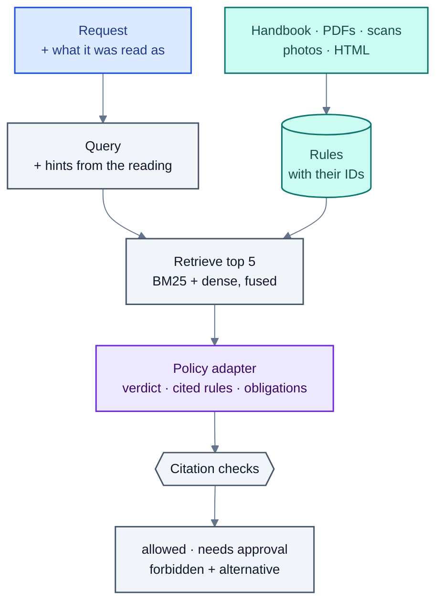

# The policy check

Is a request allowed? Layer L3 answers with a verdict and the rules it rests on: **allowed**, **needs approval**
(someone with authority decides) or **forbidden** (with the rule it breaks and, where there is one, an
alternative that would be allowed). The same check answers questions about the rules, in the chat and in the
pipeline.

## The rules

- **The handbook** (`data/handbook.md`): 16 rules, one `## <number> <title> [RULE-ID]` heading each: scope,
  authority, teaching hours, lunch, hours in a row, credits, load, preferences, make-up classes, swaps, online
  classes, labs, capacity, bookings, clashes, privacy. It is a synthetic stand-in; an institute replaces it with
  its own handbook in the same form.
- **Policy documents in any form** (`agents/documents.py`), added and removed by the timetable office on the
  Handbook page: PDFs (the text layer, or OCR for a scanned page), images (a photo of a notice, read by OCR), HTML
  pages (navigation, banners and side panels dropped) and Markdown. Each is cut into rules at its numbered
  headings, and every rule keeps where it came from. OCR runs on the CPU (RapidOCR) or on a GPU server
  (Unlimited-OCR); results are cached.
- **Together**: 32 rules from the handbook and four documents (exam regulations, a guest-faculty circular, a lab
  notice, the room booking rules).

## Retrieval

The top 5 rules are retrieved for each request (`agents/policy.py`). The query is the message plus what its
reading implies: a one-off absence adds "make-up", a run of more hours than the limit adds "consecutive". Three
retrievers:

| Retriever | How | Good at |
|---|---|---|
| `bm25` | Word matching; clock times normalised ("1pm" = "13:00") | Requests that use the rule's own words |
| `dense` | Sentence embeddings (bge-small, ONNX) and cosine similarity | Questions worded differently from the rule |
| `hybrid` (default) | Both rankings fused by reciprocal rank | Both |

Recall@5 (the right rule among the top 5):

| | BM25 | Dense | Hybrid |
|---|---|---|---|
| Corpus requests with the reading's hints (106) | 87.7% | 91.5% | **93.4%** |
| Questions in other words (40) | 65.8% | **87.8%** | 82.9% |
| Corpus requests, raw text only (106) | **77.4%** | 45.3% | 75.5% |

Dense search alone misses requests whose rule is implied rather than said ("I'm at a conference in week 7" →
the make-up rule); hybrid keeps BM25's hits there and gains most of dense search's reach on rewordings.

## The verdict

The policy adapter (`nts-read100`, task `policy`) reads the request, what the reader made of it and the retrieved
rules, and returns a verdict, the rules it cites, any obligations (such as holding a make-up class), an
explanation and, for a denial, a compliant alternative. For a question about the rules it returns an answer.

**Then the code checks it, and the checks only make it safer:**

- A citation must be one of the rules it was shown; any other is dropped and counted as made up.
- **Nothing is denied without the rule it breaks.** `forbidden` (or `needs_approval`) without a valid citation
  becomes `needs_approval` with no rule: a person decides.
- In the chat, a rule question with no rule found gets an honest "I couldn't find a rule about that", not the
  nearest rule's text.

## Rules applied by code, not by the model

Some rules are clear enough to apply directly, so no model can misread them:

- **The examination regulations** (`pipeline/exams.py`). No regular classes in the examination weeks: a change
  there is refused. No change in the weeks next to them without the Controller of Examinations: it is forwarded
  to the exam cell. The week numbers are read from the regulation's own text, so another calendar works
  unchanged.
- **Teaching hours.** A class asked for outside teaching hours or at the weekend goes to the head of department.
- **Authority.** Who may create which constraint is decided by rule when the request is read (see
  [reading-requests.md](reading-requests.md)); the room's own office (exam cell, lab in-charge) may close its
  rooms even when the reading of the rules seems to forbid it.
- **Requests made with clicks** are checked by the rule-based policy check, with no model at all.

## Results

| | Allow/deny accuracy | Deny recall (rule cited) | Make-up obligation recall |
|---|---|---|---|
| Gemini 3.5 Flash-Lite (prompted) | 98% | 0.80 | 0.21 |
| **Qwen3.5-4B + LoRA** | **99%** | **0.90** | **1.00** |

The fine-tuned model learned the make-up class rule that the prompted model misses almost every time.

## Files

| Path | What |
|---|---|
| `src/agents/policy.py` | Handbook loader, BM25, dense and hybrid retrieval, the policy agent and its checks, the rule-based stand-in |
| `src/agents/documents.py` | Policy documents in any form, OCR |
| `src/pipeline/exams.py` | The examination regulations as a rule |
| `src/evaluation/policy.py`, `retrieval.py` | Evaluation of verdicts and retrieval |
| `data/handbook.md`, `data/policies/` | The rules |
