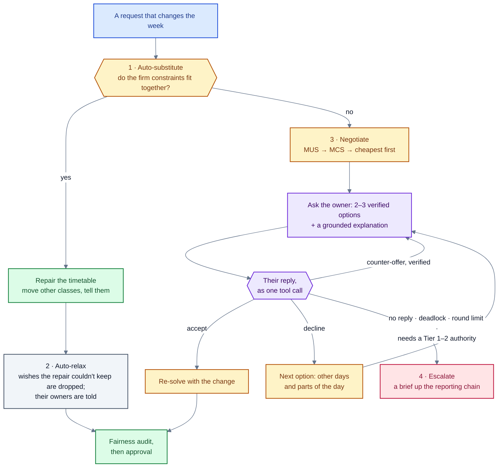

# Solving and negotiation

What happens once a request is read and allowed: the solver fits it into the week (layer L4), and when it doesn't
fit, the negotiation finds who could give way and asks them, offering only options the solver has verified
(layer L5). Then the timetable office approves the change and it is published (L6). This page also covers the
semester planner, which builds the whole semester's timetable in the first place.

## The solver

`core/solver.py` models a week's timetable in Google OR-Tools' **CP-SAT**:

- **Every class is placed once**, in a day, a start slot and a room.
- **Tier 0 rules always hold**: no teacher, section or room in two places at once, and a room that fits (size,
  lab, equipment).
- **Every other firm constraint can be switched on or off.** Each one, `C_k`, is guarded by a switch `a_k`
  (`a_k ⇒ C_k`). That is what makes conflict analysis possible: the solver can be asked "which switches can't
  all be on together?".
- **Wishes and change are costs, not rules.** Soft constraints are in the objective; in repair mode, so is every
  class moved from the published timetable, so a repair changes as little as it can.
- **Higher tiers first.** Priority tiers are solved in order (lexicographically), so a lower-tier wish can never
  outweigh a higher-tier rule.
- **Only the neighbourhood moves.** A repair can be limited to the part of the department a conflict touches;
  every other class keeps its place, which makes repairs fast. Feasible in a neighbourhood means feasible
  outright; a conflict found there is checked against the whole timetable before anyone is asked.

`core/validator.py` checks any timetable against the hard rules without the solver, and rejects compiled
constraints that name unknown IDs or impossible times.

## When it doesn't fit: conflict analysis

`core/conflicts.py`:

- **MUS (minimal unsatisfiable subset).** `find_mus` shrinks the set of firm constraints that can't hold together
  to a minimal one: every constraint in it is needed for the conflict. It answers "**why** doesn't it fit?" ("Dr.
  Das's practical and Dr. Rao's practical both need the GPU lab on Thursday afternoon, and Dr. Das is away on
  Friday").
- **MCS (minimal correction sets).** `enumerate_mcs` lists the minimal sets of relaxable constraints whose removal
  makes it fit, cheapest first. Each one is an option: "**who** could give way, and how". Each comes with a
  **witness timetable** the solver found, so every option offered is a real, complete timetable.

## Priority: whom to ask first

`agents/priority.py`. Tiers come first (a lower tier always wins; see the tier table in
[reading-requests.md](reading-requests.md#5-resolving-and-compiling)). Within a tier, each constraint `k` has a
published score:

```
π_k = w1·authority + w2·impact + w3·justification + w4·lead time + w5·credit − w6·disruption
```

A higher score means it costs more to relax. A correction option `M` (a set of constraints to relax) costs

```
cost(M) = Σ π_k over k in M  +  λ1·disruption(M)  +  λ2·ΔGini(M)
```

where ΔGini is how much less even the concession burden would become (from the ledger). The negotiator asks the
owner of the cheapest option first. The same cost, with everyone's hidden flexibility known, is the oracle's
objective in the evaluation.

## The resolution ladder

`agents/negotiation.py` climbs four rungs, stopping at the first that works:



1. **Auto-substitute.** If all the firm constraints fit together, the solver repairs the timetable (moving other
   classes if needed) and the people affected are told. Nobody is asked.
2. **Auto-relax.** Wishes the repair couldn't keep are dropped by the objective; their owners are told, and can
   ask again with the wish as a requirement.
3. **Negotiate.** The conflict is found (MUS), the options are listed (MCS) and ranked by cost, and the owner of
   the cheapest is asked, with two or three solver-verified alternatives and an explanation.
   - An option may need **several people** to give way (three classes for one lab): each is asked in turn for
     their part of the same verified repair, and what one agrees to is held while the next is asked.
   - **A declined option rules out its day and part of the day** for that class, so the next options look
     elsewhere instead of next door: nearest to what was asked first, then further out.
   - **A counter-offer is offered onward only if the solver verifies it.**
4. **Escalate.** On a deadlock, no reply, the round limit, or a conflict only a Tier 1–2 authority could relax, a
   brief goes up the reporting chain (the HOD, the timetable office, the Dean), who decides.

### Replies become tool calls

A person answers in their own words ("Thursday works, but not before 11"). The reply adapter (`nts-read100`, task
`reply`) turns it into **exactly one typed tool call**:

| Call | Meaning |
|---|---|
| `accept(option_id)` | Take an offered option |
| `apply_reply(constraint)` | Accept with a change: part of an option |
| `counter_propose(option)` | Suggest another time |
| `ask_clarification(question)` | Ask before deciding |
| `decline(reason)` | Say no |
| `escalate(reason)` | Hand it to someone with authority |

**The ladder, not the model, decides what each call does.** The model only reads the reply; it can't move a
class. A rule-based reply reader is the stand-in when there is no model.

### Explanations without leaks

`agents/explainer.py`. A conflict is turned into numbered **facts**: the constraints in the conflict, the rules
they come from, which rooms have the equipment, the verified options and the ledger history. Facts name the
**constraint**, never the private **reason** behind it ("Dr. Rao is unavailable on Friday", never "Dr. Rao has a
medical appointment"). Explanations are built only from facts:

- **Template**: one plain sentence per fact, no model.
- **Grounded**: the model writes claims, each citing fact IDs; a checker drops any claim that cites nothing,
  cites an unknown fact, or mentions a day, number or name not in the facts it cites.

So a private reason can only leak if a model invents it, and the checker catches made-up details.

## Fairness: the concession ledger

`agents/ledger.py`. Every accepted concession adds credit to the person who gave way:
`importance(k) × magnitude(k)`. Giving up a verified absence weighs more than giving up a wish; a partial
concession weighs less than dropping the constraint entirely. Credit lowers a person's chance of being asked to
give way again, and it decays each semester, so history matters without dominating. How unevenly the burden falls
is measured by the Gini coefficient, the largest individual burden and the coefficient of variation. Teachers see
their own place on the Fairness page.

## Approval, publishing and rollback

- **A change that moves classes waits for the timetable office** (`Orchestrator.approve`, `reject`). One that
  moves nothing is published at once.
- **Publishing** makes a new timetable version and tells everyone it reaches, in their inbox and their chat.
- **Versions** are kept; the office can compare two (`versions/diff`) and **roll back** to an earlier one.
- **Withdrawal**: the sender can take a request back before it changes the published timetable.
- **Autopilot** (for demos): a simulated person answers negotiation messages on a teacher's behalf, so a
  negotiation can be watched end to end without signing in as everyone.

## Simulated people (for the evaluation)

`agents/simulators.py`. A simulated teacher states a constraint as absolute but privately knows which other
times would really work, whether a room without the equipment would do, whether they volunteer an alternative,
and whether they answer at all. Four styles shape these: strict, flexible, cost-sensitive (only small changes),
and history-sensitive (refuses more often after giving way recently). Replies are random within the style, so no
system can win by exploiting a fixed reply rule.

## The semester planner

Before any weekly change, the semester's timetable has to exist. `semester/` builds it from the institute's
**course offering document** (what is taught, by whom, to which programmes):

- **Reading the document** (`semester/offerings.py`): a PDF table is read by position (wrapped cells join their
  row), scans and web pages through OCR; one row per course with its L-T-P-C credits and teachers.
- **The institute's week** (`semester/solver.py`): six 85-minute lecture slots; Monday–Wednesday repeated on
  Thursday–Saturday (a course with three or more lecture hours meets twice, same slot, three days apart);
  tutorials on an hourly grid; labs in blocks of up to three hours; Wednesday and Saturday afternoons free.
- **Preferences in plain words** (`semester/requests.py`): "Dr. Menon prefers not to teach before 10 am", "Room
  R-101 is closed on Tuesdays". "Can't", "unavailable", "must" make a hard rule; anything else is a weighted
  wish. Dates ("on leave 10–20 August") are sent back with a question, not misread as weekly times.
- **A service** (`semester/service.py`): builds run in the background (about a minute); nothing is live until the
  timetable office publishes a version.
- **Club bookings** (`semester/clubs.py`): a room for a club activity in the evenings or the free afternoons,
  checked automatically (club hours, two days' notice, five for the auditorium, no member's class at that time, a
  room that is big enough and free); large events and the auditorium go to the office; a failed request comes
  back with the checks it failed and alternatives that pass.

## The knowledge graph

`core/graph.py` links people, constraints, classes, rooms, requests, rules and changes: who owns what, who has
authority over whom, which constraints conflict (from MUS results), and each person's fairness balance. The
timetable office explores it on the Knowledge graph page.

## Results

From the main experiment (details in [evaluation.md](evaluation.md)): solver-grounded negotiation reaches the
oracle's outcome in **89.4%** of runs, against 75.6% when the model invents options that the solver filters
(p = 4.6×10⁻⁶) and 83.3% when they are offered unchecked (p = 0.013); its timetables are almost as good as the
oracle's (gap 0.04 against 0.63 and 0.44), and it never offered an impossible option. Grounded explanations
leaked no private reason (12 leaks with free-text explanations).

## Files

| Path | What |
|---|---|
| `src/core/solver.py`, `semantics.py`, `validator.py` | The CP-SAT model, what each constraint means, checks |
| `src/core/conflicts.py` | MUS and MCS |
| `src/agents/negotiation.py` | The resolution ladder, replies as tool calls |
| `src/agents/priority.py`, `ledger.py` | Priority scores, the concession ledger |
| `src/agents/explainer.py` | Facts, template and grounded explanations |
| `src/agents/simulators.py` | Simulated stakeholders |
| `src/pipeline/orchestrator.py` | Solving, negotiating, approving and publishing a request |
| `src/semester/` | The semester planner and club bookings |
| `src/core/graph.py` | The knowledge graph |
