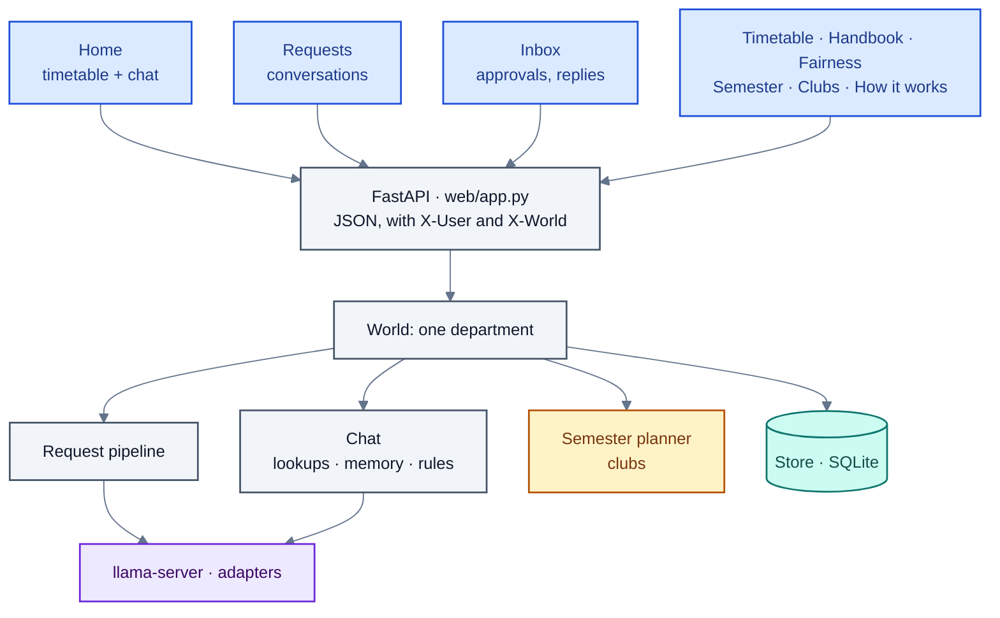

# The web app

A React + TypeScript + Tailwind front end (`frontend/`) on a FastAPI back end (`src/web/`). `uv run nts-web` builds
the front end when its sources changed and serves both on http://127.0.0.1:8000. Every screen is the same app for
every role; what a person sees is decided by their role (`VIEWS` in `web/world.py`), and the endpoints behind a
restricted view check the role as well.

## Signing in

The demo signs people in by choosing who they are (`GET /api/personas`, `POST /api/login`): a teacher, the HOD, a
class representative, the timetable office, the Dean, the lab in-charge or the exam cell. Who is signed in, and
in which world, is kept per browser tab (`lib/api.ts`, in `sessionStorage`), so several people can be open side by
side in different tabs. Every API call carries the person (`X-User`) and the world (`X-World`; the demo
department when none is named).

## The home page: the timetable and the chat

`pages/Home.tsx` is the workspace for every role that teaches or represents a class: the week's timetable on one
side and the chat on the other, talking to each other through a shared workspace (`lib/workspace`).

**The timetable** (`components/TimetableGrid.tsx`, `WeekStepper.tsx`, `WeekCalendar.tsx`)

- The person's own week (a teacher's classes, a class representative's section), with arrows and a strip of week
  numbers to move through the semester.
- **Click a class** to cancel it, move it or swap it with a colleague's, right there (`ClassActions.tsx`), or to
  name it in the chat message being written. The popup shows the free slots the class could move to and the
  colleagues' classes it could swap with that week (`lib/scheduling.ts`: the teacher and the sections must be
  free, lunch stays free, a day that is over is out). These are hints; the solver checks the rest.
- **Free hours from an answer are shaded** on it, so "when am I free on Friday?" lights up Friday.

**The chat** (`components/ChatPanel.tsx`, the cards in `components/thread/`)

- One box for timetable questions, questions about the rules, and requests, follow-ups included. Example
  messages of each kind are offered when the chat is empty (`lib/examples.ts`).
- A timetable answer comes with its part of the timetable drawn as a card: a week grid, or one row per room or
  person for a day (`lib/slots.ts` lays out each line of an answer: a stretch of free time, a class, a change).
- A rule answer lists the rules it cites; each opens beside the chat.
- A request becomes a request card that follows its status live, with "it's a question" for the rare misreading.
- A follow-up shows what it was read as ("and Friday?" → "when am I free on Friday?").
- Requests made with clicks on the timetable appear in the chat too, as cards.
- When the model is away the chat says so, instead of guessing.

How the chat reads and answers a message is in [chat-lookups-memory.md](chat-lookups-memory.md).

## Making a request with clicks

Two builders make a request without any model reading it: the request is sent as data (its intents), together
with the same request in words, which is what people see.

**New request** (`components/RequestBuilder.tsx`). Pick a week, a day, and one of your classes; then either write
what should happen, or with a few clicks:

| Action | What the builder offers |
|---|---|
| Reschedule | A free slot for that class in that week, and which weeks it applies to (this week only, from this week on, picked weeks) |
| Swap | A colleague's class it can actually be swapped with that week |
| Cancel | Which weeks |

**A range of dates** (`components/RangeBuilder.tsx`). Pick the dates, then the classes you teach in them (all of
them, all of one course, or some), then:

- **Cancel** them: one request, with or without make-up classes;
- **Move** them: you are away at those classes' times and the solver finds new times; one request per week, since
  a request repairs one week.

The longest range allowed is a setting of the timetable office.

## Requests and conversations

- **Requests** (`pages/Requests.tsx`, `RequestChat.tsx`, `components/Conversations.tsx`,
  `ConversationPane.tsx`). Everything a person is told, as conversations: one per request of theirs, and one per
  colleague's request that asks something of them or changed their timetable. The composer under an open
  conversation answers its question, replies to options sent to the person, or writes a new request.
  Finished requests can be taken off the list (`RequestsTable.tsx`).
- **A request's details** (`components/DetailsDrawer.tsx`, `pages/CaseDetail.tsx`). How the system handled it:
  the lifecycle lit up from the event log (`Lifecycle.tsx`), what it was read as, the rules checked, the solver's
  result, the negotiation round by round, and fairness. A negotiation message is shown as its recipient sees it
  (`LetterView.tsx`), and a grounded explanation with the facts each sentence rests on (`Negotiation.tsx`).
- **Clarifications** (`components/Clarify.tsx`). A request sent back with a question is answered in place, and the
  request goes through again with the answer.

## Pages by role

| Page | Who | What |
|---|---|---|
| Home | Everyone | The timetable and the chat (above). The HOD's home adds the department's escalations on top (`DepartmentStrip.tsx`); the lab in-charge and exam cell see their rooms for the week (`RoomsOverview.tsx`) |
| Requests | Everyone | Their requests as conversations; the office, HOD and Dean see the department's |
| Inbox | Everyone | What waits on the person: negotiation options to answer, changes to approve (the office), escalations to decide, forwarded messages, notices of changes |
| Timetable | Everyone | Browse any week: the office, HOD and Dean everything, a teacher their own classes |
| Handbook | Everyone | Every rule the policy check can cite; the office adds and removes policy documents (PDF, HTML, scans) |
| Fairness | Teachers, office, Dean | The concession ledger: who has given way, how often |
| How it works | Everyone | The pipeline shown working: a message travels through each stage, a negotiation plays out round by round; every caption comes from the running system (`/api/transparency`) |
| Semester | Office | Build the semester timetable from the course offering document, with preferences, versions and publishing |
| Preferences | Teachers, students | Semester preferences in plain words |
| Clubs | Office, students | Evening club room bookings, checked automatically; the office decides what needs a decision |
| Knowledge graph | Office | People, classes, rooms, constraints and requests as an explorable graph |
| Health | Office | Is it working, and what to improve next: checks worst first, each with what it means and a next step |
| Experiments | Office | The evaluation runs and their results |
| Human study | Office | Participant codes, progress, agreement, export |
| Settings | Everyone | Each person's own choices (theme, layout); the office's section sets what applies to everyone (such as the longest range of dates a request may cover) |

The timetable office can also move between **worlds** (`components/WorldSwitcher.tsx`): the demo department, and
departments built from a course offering document.

## The API

Grouped by area (all under `/api`; `web/app.py` unless noted):

| Area | Endpoints |
|---|---|
| Sign-in and the department | `GET personas`, `POST login`, `GET me`, `GET overview`, `GET instance`, `GET calendar`, `GET weekly-changes` |
| Chat | `GET/POST/DELETE chat`, `POST chat/confirm`, `POST chat/as-question`, `POST ask` (one question) |
| Requests | `POST requests` (in words), `POST requests/form` (with clicks), `GET cases`, `GET cases/{id}`, `POST cases/{id}/clarify`, `withdraw`, `hide`, `decide`, `handle`, `act` |
| Inbox and negotiation | `GET inbox`, `GET feed`, `POST feed/seen`, `POST inbox/{id}/reply`, `reply-text`, `simulate` |
| Approval and versions | `GET approvals`, `POST approvals/{id}/approve`, `reject`, `GET versions`, `GET versions/diff`, `POST versions/{v}/rollback`, `GET timetable` |
| Rules | `GET handbook`, `GET handbook/search`, `GET/POST handbook/documents`, `DELETE handbook/documents/{name}` |
| Fairness and insight | `GET ledger`, `GET graph`, `GET transparency`, `GET observability`, `GET experiments`, `GET events` |
| Settings | `GET/POST settings`, `GET/POST autopilot` |
| Worlds and demo | `GET/POST worlds`, `DELETE worlds/{id}`, `POST demo/reset` |
| Semester (`web/semester.py`) | `GET semester`, `semester/public`, `semester/status`, `semester/timetable`; `POST semester/offerings`, `sizes`, `preferences`, `build`, `changes`, `versions/{v}/publish` |
| Clubs (`web/semester.py`) | `GET/POST clubs`, `POST clubs/{booking}/decide` |
| Human study (`web/study.py`) | `study/me`, `consent`, `next/{task}`, `labels`, `practice`, `live`, `admin`, `participants`, `export` |

Requests run in background threads, so `POST requests` answers at once with the request's id; the page then
follows the request's states (`GET cases/{id}`).

## Files

| Path | What |
|---|---|
| `frontend/src/App.tsx` | Routes, each behind its view's guard |
| `frontend/src/pages/` | One file per page |
| `frontend/src/components/` | The timetable, the chat, the builders, conversations, cards |
| `frontend/src/lib/api.ts`, `types.ts` | The API client and the shapes it returns |
| `frontend/src/lib/scheduling.ts`, `slots.ts`, `weeks.ts`, `requests.ts` | Hints for clicks, answer lines, a request's weeks, status order |
| `src/web/app.py` | The API and `nts-web` |
| `src/web/world.py`, `worlds.py` | A department's world, several worlds in one server |
| `src/web/fallback.py` | Working while the model server is away |
| `src/web/semester.py`, `study.py`, `portal.py` | Semester and clubs, the human study, the channel portal |
